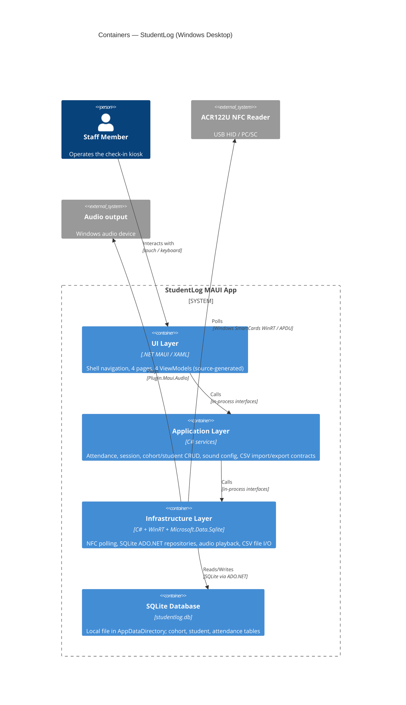

# StudentLog Architecture Review

**Reviewed:** 2026-06-17 (updated from 2026-05-15 original)  
**Reviewer:** Architect Agent  
**Codebase branch:** feat/sqlite-migration (original review at commit 860b547)

---

## Current State

### What the App Does

StudentLog is a Windows 10+ desktop application that manages student attendance via NFC card scanning. A staff member selects a cohort and a session type (Clock In or Clock Out), then starts a session. The ACR122U NFC reader polls for card taps every 200 ms; each scan is matched to a student record and written to a local SQLite database. The UI also supports manual student registration (with optional NFC UID scan), cohort management, per-student attendance history, CSV export, CSV bulk import of student rosters, and per-cohort/per-student configurable audio feedback on scan events.

### Tech Stack Summary

| Concern | Choice |
|---|---|
| UI framework | .NET MAUI 10, Shell navigation |
| MVVM toolkit | CommunityToolkit.Mvvm 8.4 (ObservableObject, RelayCommand source generators, WeakReferenceMessenger) |
| Database | Local SQLite via Microsoft.Data.Sqlite 9.0.0 (raw ADO.NET, no ORM) |
| NFC hardware | ACR122U reader via Windows.Devices.SmartCards WinRT API |
| CSV export/import | CsvHelper 33.1 with Windows FileSavePicker / FilePicker |
| Audio feedback | Plugin.Maui.Audio 4.0.0 |
| Configuration | Microsoft.Extensions.Configuration.Json 10.0.0 |
| Target | Windows only (net10.0-windows10.0.19041.0) |

> **Migration note:** The original codebase used a remote MySQL server via MySqlConnector 2.4. The `feat/sqlite-migration` branch replaces this with an embedded SQLite file stored at `FileSystem.AppDataDirectory/studentlog.db`. This fundamentally changes the deployment model: each installation now carries its own local database rather than connecting to a shared server.

---

## Project Structure

```
StudentLog/
├── Core/
│   ├── Models/
│   │   ├── Student.cs                    (Id, UID, CohortId, name, surname, SignInTime, SignOutTime,
│   │   │                                   ClockInSoundPath, ClockOutSoundPath)
│   │   ├── Cohort.cs                     (Id, Name, ClockInSoundPath, ClockOutSoundPath)
│   │   ├── AttendanceRecord.cs           (StudentId, SessionDate, SignInTime, SignOutTime + computed Duration)
│   │   ├── AttendanceScanResult.cs       (sealed result type)
│   │   └── SessionType.cs                (enum: ClockIn, ClockOut)
│   └── Interfaces/
│       ├── IDbConnectionFactory.cs       (moved from Infrastructure — returns IDbConnection)
│       └── Repositories/
│           ├── ICohortRepository.cs
│           └── IStudentRepository.cs     (includes GetByCohortAndPeriodAsync, GetAttendanceHistoryAsync)
├── Application/
│   ├── Interfaces/
│   │   ├── IAttendanceService.cs
│   │   ├── ICohortService.cs
│   │   ├── IStudentService.cs
│   │   ├── INfcService.cs
│   │   ├── ISessionStateService.cs
│   │   ├── IDialogService.cs             (new — decouples prompt UI from NfcService)
│   │   ├── ISoundService.cs              (new — audio feedback on scan events)
│   │   ├── ISoundConfigService.cs        (new — configure per-cohort/per-student sounds)
│   │   ├── ICsvExportService.cs
│   │   ├── ICsvImportService.cs          (new — CSV bulk student import)
│   │   └── IDatabaseInitializationTracker.cs (new — async init gate for ViewModels)
│   ├── Services/
│   │   ├── AttendanceService.cs
│   │   ├── CohortService.cs
│   │   ├── StudentService.cs
│   │   ├── SessionStateService.cs        (thread-safe via C# 13 Lock primitive)
│   │   └── SoundConfigService.cs         (new)
│   └── Csv/
│       ├── AttendanceRecordMap.cs
│       ├── CsvImportResult.cs            (new — import DTO)
│       └── StudentImportRow.cs           (new — CSV row DTO)
├── Infrastructure/
│   ├── Data/
│   │   ├── IDbConnectionFactory.cs       (empty stub — interface lives in Core.Interfaces)
│   │   ├── SqliteConnectionFactory.cs    (replaces MySqlConnectionFactory)
│   │   └── DatabaseInitializer.cs        (CREATE TABLE IF NOT EXISTS; ALTER TABLE for migrations;
│   │                                       seed data guarded by #if DEBUG)
│   ├── Repositories/
│   │   ├── CohortRepository.cs           (SQLite ADO.NET implementation)
│   │   └── StudentRepository.cs          (SQLite ADO.NET implementation; accepts IDbTransaction?)
│   └── Services/
│       ├── NfcService.cs                 (WinRT polling; reader cached; DeviceWatcher for removal)
│       ├── SoundService.cs               (new — Plugin.Maui.Audio playback)
│       └── DatabaseInitializationTracker.cs (new — TaskCompletionSource gate)
├── UI/
│   ├── ViewModels/                       (all partial class; [ObservableProperty] / [RelayCommand])
│   │   ├── CheckInSessionViewModel.cs
│   │   ├── CohortsViewModel.cs
│   │   ├── StudentsViewModel.cs
│   │   └── StudentHistoryViewModel.cs
│   ├── Views/
│   │   ├── CheckInSessionPage.xaml/.cs
│   │   ├── CohortsPage.xaml/.cs
│   │   ├── StudentsPage.xaml/.cs
│   │   └── StudentHistoryPage.xaml/.cs
│   ├── Services/
│   │   └── MauiDialogService.cs          (new — implements IDialogService)
│   ├── Messaging/
│   │   └── AttendanceRecordedMessage.cs
│   └── Converters/
│       ├── PathToFileNameConverter.cs    (new)
│       ├── SignInStatusConverter.cs
│       └── StringToBoolConverter.cs
├── Platforms/
│   └── Windows/
│       ├── App.xaml/.cs
│       ├── CsvExportService.cs
│       ├── CsvImportService.cs           (new — FilePicker + CsvHelper import)
│       └── WindowsSoundSuppressor.cs     (new)
├── appsettings.json                      (present; currently empty — no secrets needed for SQLite)
├── App.xaml.cs                           (kicks off DatabaseInitializer + signals tracker)
├── AppShell.xaml/.cs
└── MauiProgram.cs                        (DI composition root)
```

---

## Key Components

| Class | Layer | Responsibility |
|---|---|---|
| `MauiProgram` | Composition root | Wires DI container; loads `appsettings.json`; registers all services |
| `App` | Application host | Creates Window; runs `DatabaseInitializer`; signals `IDatabaseInitializationTracker` |
| `AppShell` | UI | Shell navigation host; registers `studenthistory` deep-link route |
| `SqliteConnectionFactory` | Infrastructure | Opens a new `SqliteConnection` per call to `AppDataDirectory/studentlog.db` |
| `DatabaseInitializer` | Infrastructure | DDL (`CREATE TABLE IF NOT EXISTS`); `ALTER TABLE` for additive column migrations; seed data only in `#if DEBUG` |
| `CohortRepository` / `StudentRepository` | Infrastructure | Raw ADO.NET queries against SQLite; manual reader-to-model mapping; accept optional `IDbTransaction?` |
| `AttendanceService` | Application | Validates session; resolves student by UID; wraps two writes in a single transaction |
| `SessionStateService` | Application | Thread-safe in-memory singleton (C# 13 `Lock`) holding active cohort, session type, and date |
| `NfcService` | Infrastructure | Caches `SmartCardReader` on session start; polls every 200 ms via `FindAllCardsAsync`; `DeviceWatcher` for plug/unplug; duplicate-UID suppression |
| `SoundService` | Infrastructure | Plays per-student or per-cohort audio file on scan events via Plugin.Maui.Audio |
| `SoundConfigService` | Application | Reads/writes `ClockInSoundPath`/`ClockOutSoundPath` on `Cohort` or `Student` via repository |
| `CsvExportService` | Platform (Windows) | Opens `FileSavePicker`, writes UTF-8 BOM CSV with CsvHelper |
| `CsvImportService` | Platform (Windows) | Opens `FilePicker`, parses student CSV with CsvHelper; deduplication done in ViewModel |
| `MauiDialogService` | UI | Implements `IDialogService`; calls `DisplayPromptAsync` / `DisplayAlert` via `Application.Current` |
| `DatabaseInitializationTracker` | Infrastructure | `TaskCompletionSource` gate; ViewModels await `WaitAsync()` before loading data |
| `CheckInSessionViewModel` | UI | Orchestrates session lifecycle; relays NFC scans to `AttendanceService`; triggers audio |
| `CohortsViewModel` | UI | Cohort CRUD; Day/Month/Year attendance filter (queries `attendance` table via service); CSV export; sound config |
| `StudentsViewModel` | UI | Student CRUD; NFC UID capture; CSV import; per-student sound config; history navigation |
| `StudentHistoryViewModel` | UI | Per-student attendance history; per-student CSV export |

---

## Data Flow

### NFC Scan to Clock-In/Out Record (happy path)

```
ACR122U hardware
      |
      | Windows SmartCards WinRT
      v
NfcService._reader (cached SmartCardReader, resolved once on StartListeningAsync)
  - _reader.FindAllCardsAsync()
  - APDU command: FF CA 00 00 00  (GET UID)
  - Returns hex UID string; duplicates suppressed by lastUid comparison
      |
      | 200 ms polling loop (Task.Run background thread)
      v
NfcService → onUidScanned(uid) callback
      |
      v
CheckInSessionViewModel (lambda passed to StartListeningAsync)
  - calls AttendanceService.RecordScanAsync(sessionType, uid)
      |
      v
AttendanceService.RecordScanAsync()                [Application]
  1. Guard: ISessionStateService.IsSessionActive
  2. Normalize UID: uid.Trim().ToUpperInvariant()
  3. StudentRepository.GetByUidAsync(uid)           [SQLite]
  4. Guard: student.CohortId == ActiveCohortId
  5. Open connection + begin transaction
  6. StudentRepository.UpdateAttendanceAsync()      [UPDATE student SET SignInTime/SignOutTime]
  7. StudentRepository.UpsertDailyAttendanceAsync() [INSERT OR REPLACE attendance]
  8. Commit transaction
  9. Return AttendanceScanResult.Recorded(student, sessionType, timestamp)
      |
      v
CheckInSessionViewModel (callback continues)
  - ISoundService.PlayAsync(student, cohort, sessionType)  → audio feedback
  - MainThread.BeginInvokeOnMainThread()
  - Updates StatusMessage, LastScannedStudentName
  - WeakReferenceMessenger.Default.Send(AttendanceRecordedMessage)
      |
      v
CohortsViewModel (registered listener)
  - Calls LoadStudentsForSelectedAsync()  → IStudentService → SQLite
      |
      v
UI bindings update CollectionView
```

### Database Initialization Gate

```
App.OnStart()
  → DatabaseInitializer.InitializeAsync()   [creates tables; DEBUG seed]
  → IDatabaseInitializationTracker.SignalComplete()

CheckInSessionViewModel.LoadAsync()
  → IDatabaseInitializationTracker.WaitAsync()   [blocks until signal]
  → loads cohorts
```

### Attendance Dual-Write Pattern

`AttendanceService` writes to two tables on every scan inside a single transaction:
- `student.SignInTime` / `student.SignOutTime` — running current state per student
- `attendance.(StudentId, SessionDate)` — permanent per-day record (the source of truth for history and period filters)

The `student`-level timestamps are a legacy denormalization. They are still present and still written but are no longer the source for Month/Year filters — those now query the `attendance` table directly.

---

## Architectural Issues — Status Update

The original review identified 14 issues. Status as of the `feat/sqlite-migration` branch:

---

### Issue 1 — ~~CRITICAL: Hardcoded Production Credentials~~ — **RESOLVED (by design)**

**Original concern:** MySQL root password baked into `MySqlOptions.cs`.

**Resolution:** The SQLite migration eliminates this issue entirely. SQLite uses a local file path (`FileSystem.AppDataDirectory/studentlog.db`) derived at runtime — no credentials. `appsettings.json` exists but is currently empty. No secrets are in source.

> If a future version adds remote sync or an admin password, load those via `IOptions<T>` bound from `appsettings.json` (gitignored). The configuration plumbing (`Microsoft.Extensions.Configuration.Json`) is already in place.

---

### Issue 2 — ~~HIGH: IDbConnectionFactory Leaks Infrastructure Type~~ — **RESOLVED**

**Resolution:** `IDbConnectionFactory` now lives in `StudentLog.Core.Interfaces` and returns `Task<System.Data.IDbConnection>`. The Infrastructure stub at `Infrastructure/Data/IDbConnectionFactory.cs` is an intentional empty file left as a redirect comment. `SqliteConnectionFactory` implements the Core interface.

---

### Issue 3 — ~~HIGH: Dual-Write Not Atomic~~ — **RESOLVED (short-term)**

**Resolution:** `AttendanceService.RecordScanAsync` now opens a connection, begins a transaction, passes it to both `UpdateAttendanceAsync` and `UpsertDailyAttendanceAsync`, and commits or rolls back atomically. Both repository methods accept `IDbTransaction?`.

**Still pending (long-term):** The `student` table still carries `SignInTime`/`SignOutTime`. These are denormalized copies of data that lives authoritatively in `attendance`. Removing them would eliminate the dual-write entirely and simplify the model. This is now lower-risk given the transaction wrapper, but remains a correctness liability if the data ever diverges.

---

### Issue 4 — ~~HIGH: NfcService Device Discovery Hot Loop~~ — **RESOLVED**

**Resolution:** `NfcService` now caches the `SmartCardReader` reference when `StartListeningAsync` is called. The 200 ms polling loop calls `_reader.FindAllCardsAsync()` — not `DeviceInformation.FindAllAsync()`. A `DeviceWatcher` monitors for USB removal events; on removal, `_reader` is cleared and the next poll re-resolves. This is the correct WinRT pattern.

---

### Issue 5 — ~~MEDIUM: SessionStateService Thread Safety~~ — **RESOLVED**

**Resolution:** `SessionStateService` uses the C# 13 `Lock` primitive to guard all reads and writes. The NFC background thread and the UI thread can safely access session state concurrently.

---

### Issue 6 — MEDIUM: StopListeningAsync May Block Calling Thread — **STATUS UNCERTAIN**

**Original concern:** `_listeningTask.Wait(TimeSpan.FromSeconds(2))` blocks the UI thread.

**Current state:** The agent report notes NfcService "waits up to 2 seconds for listener task to complete on StopListeningAsync" but does not confirm whether this is via `await` or `Task.Wait`. Verify `NfcService.StopListeningAsync` uses `await _listeningTask.WaitAsync(TimeSpan.FromSeconds(2))` (not `.Wait()`). If it still uses `.Wait()`, the 2-second UI freeze risk remains.

---

### Issue 7 — ~~MEDIUM: Month/Year Filter Used Stale Student Timestamps~~ — **RESOLVED**

**Resolution:** `IStudentRepository` now exposes `GetByCohortAndPeriodAsync(int cohortId, DateOnly from, DateOnly to)`. `CohortsViewModel` maps its filter scopes (Day/Month/Year) to appropriate date ranges and calls `IStudentService.GetStudentsForPeriodAsync()`, which queries the `attendance` table — not the stale `student.SignInTime`/`SignOutTime` columns.

---

### Issue 8 — ~~MEDIUM: NfcService Reached Into the UI Layer~~ — **RESOLVED**

**Resolution:** `IDialogService` is defined in `Application.Interfaces` with `PromptAsync`, `ShowAlertAsync`, and `ConfirmAsync`. `MauiDialogService` in `UI/Services/` implements it using `Application.Current`. `NfcService.ScanSingleUidAsync` no longer calls `DisplayPromptAsync` directly. `StudentsViewModel` handles the prompt fallback via `IDialogService`.

---

### Issue 9 — ~~MEDIUM: ViewModels Not Using Source Generators~~ — **RESOLVED**

**Resolution:** All four ViewModels are now `partial class` extending `ObservableObject`. Properties use `[ObservableProperty]` on backing fields; async command methods use `[RelayCommand]`. Property change side-effects use the toolkit's `partial void On{Property}Changed` pattern (e.g., `OnSelectedCohortChanged` triggers a reload in `CohortsViewModel`).

---

### Issue 10 — ~~MEDIUM: Redundant Re-Fetch After Attendance Write~~ — **RESOLVED**

**Resolution:** `AttendanceService.RecordScanAsync` returns `AttendanceScanResult.Recorded(student, sessionType, timestamp)` using the already-fetched `student` object — no third round-trip to the database. The `student`-table fields are updated in the transaction before the result is returned, keeping the in-memory object consistent.

> Note: With SQLite (local file, in-process), the latency of an extra read is far lower than with remote MySQL, but eliminating it was still the correct choice.

---

### Issue 11 — ~~MEDIUM: Seed Data in Production Initializer~~ — **RESOLVED**

**Resolution:** `DatabaseInitializer` guards the test-data seed block with `#if DEBUG`. Production builds run DDL only.

---

### Issue 12 — MEDIUM: CohortsViewModel Projects Student→AttendanceRecord for Export — **PARTIALLY RESOLVED**

**Original concern:** CSV export projected `Student.SignInTime`/`SignOutTime` (stale single-day timestamps) into `AttendanceRecord` objects inside the ViewModel.

**Current state:** With the period query now hitting the `attendance` table (Issue 7 fix), the export path should be reviewed to confirm it uses `AttendanceRecord` data from the service rather than re-projecting from `Student`. If `ExportCsvAsync` still projects from the `Students` observable collection, the export will only contain one row per student (today's sign-in/out) rather than the full period. Verify and update if needed.

---

### Issue 13 — LOW: NfcService Lacks IAsyncDisposable — **STATUS UNCERTAIN**

**Original concern:** `NfcService` holds a `CancellationTokenSource` and background task without implementing `IAsyncDisposable`.

**Current state:** Unconfirmed whether `NfcService` now implements `IAsyncDisposable`. Verify: the class should cancel its CTS and await the polling task on disposal. The DI container will call `DisposeAsync` on singleton disposables automatically.

---

### Issue 14 — LOW: Logging Uses Debug.WriteLine — **PARTIALLY RESOLVED**

`ILogger<T>` is injected into ViewModels and service classes; structured log calls have replaced many `Debug.WriteLine` usages. The `Microsoft.Extensions.Logging.Debug` sink is registered in `MauiProgram`. No structured production sink (file, EventLog) is configured; for a deployed kiosk, consider adding `Serilog.Sinks.File` or `Microsoft.Extensions.Logging.EventLog` in `MauiProgram`.

---

### NEW: Issue 15 — LOW: Student Table Retains Denormalized Timestamps (Long-Term Tech Debt)

**Severity: Low**  
**Files:** `StudentLog/Core/Models/Student.cs`, `StudentLog/Infrastructure/Data/DatabaseInitializer.cs`, `StudentLog/Infrastructure/Repositories/StudentRepository.cs`

`Student.SignInTime` / `Student.SignOutTime` are still present in the model and schema. With the `attendance` table as the authoritative record and the period filter now querying it correctly, these columns serve only as a cache for a ViewModel convenience (displaying "last seen" in the main student list). The dual-write transaction (Issue 3 fix) reduces the risk but the denormalization remains.

**Remediation (when ready):** Remove `SignInTime`/`SignOutTime` from `Student`. Replace any ViewModel reads of these fields with a join or lookup against `attendance`. Drop the `DatabaseInitializer` UPDATE that writes them. This eliminates the dual-write entirely.

---

### NEW: Issue 16 — LOW: Empty appsettings.json Has No Purpose

**Severity: Low**  
**File:** `StudentLog/appsettings.json`

The file exists and is copied to output but contains `{}`. This is fine as a placeholder, but its presence could mislead contributors into thinking it controls something. Either populate it with real settings (e.g., log level, feature flags) or leave it with a comment explaining it is reserved for future configuration.

---

## Architecture Diagrams

### C4 Container Diagram (Current State)



### Dependency Flow (Current — no violations)

```
UI  ──────────────────────────────────►  Application  ──────►  Core
│                                              │                   ▲
│  Platforms/Windows/CsvExportService          │                   │
│      implements ICsvExportService ───────────┘                   │
│  Platforms/Windows/CsvImportService                              │
│      implements ICsvImportService ───────────────────────────────┘
│  UI/Services/MauiDialogService                                   │
│      implements IDialogService ──────────────────────────────────┘
│                                                                  │
Infrastructure  ──────────────────────────────────────────────►  Core
    SqliteConnectionFactory implements IDbConnectionFactory
    CohortRepository / StudentRepository implement Core.Interfaces.Repositories
    NfcService / SoundService implement Application.Interfaces
```

---

## Implementation Roadmap — Updated Status

| Priority | Description | Status |
|----------|-------------|--------|
| 1 | Externalise credentials (Issue 1) | ✅ Resolved — no credentials needed for SQLite |
| 2 | Atomic attendance write (Issue 3) | ✅ Resolved — transaction in AttendanceService |
| 3 | Fix NFC device discovery hot loop (Issue 4) | ✅ Resolved — reader cached; DeviceWatcher added |
| 4 | Fix Month/Year filter (Issues 7, 3 long-term) | ✅ Resolved for filter; denorm columns still present |
| 5 | Move IDbConnectionFactory to Core (Issue 2) | ✅ Resolved |
| 6 | Decouple NfcService from UI (Issue 8) | ✅ Resolved — IDialogService introduced |
| 7 | Thread safety + NfcService lifetime (Issues 5, 13) | ✅ (5) / ❓ (13 — verify IAsyncDisposable) |
| 8 | Source-generate ViewModel boilerplate (Issue 9) | ✅ Resolved |
| 9 | Replace Debug.WriteLine with ILogger (Issue 14) | ⚠️ Partial — no production log sink configured |
| 10 | Remove dev seed data from prod (Issue 11) | ✅ Resolved — guarded by #if DEBUG |
| 11 | Eliminate redundant re-fetch (Issue 10) | ✅ Resolved |
| — | Verify StopListeningAsync not blocking (Issue 6) | ❓ Uncertain — check .Wait() vs await |
| — | Verify CSV export uses AttendanceRecord (Issue 12) | ❓ Uncertain — verify export path |
| — | Remove denormalized Student timestamps (Issue 15) | 🔲 Not started — lower risk now, still pending |
| — | Add production log sink | 🔲 Not started |
